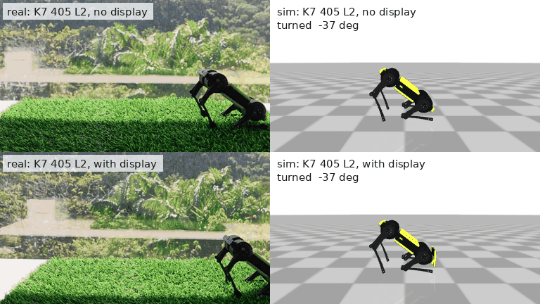
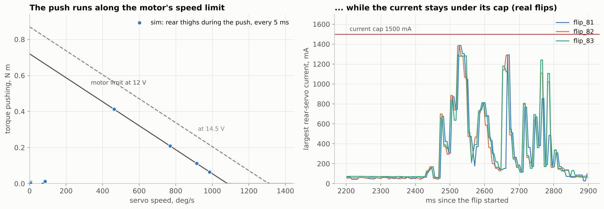
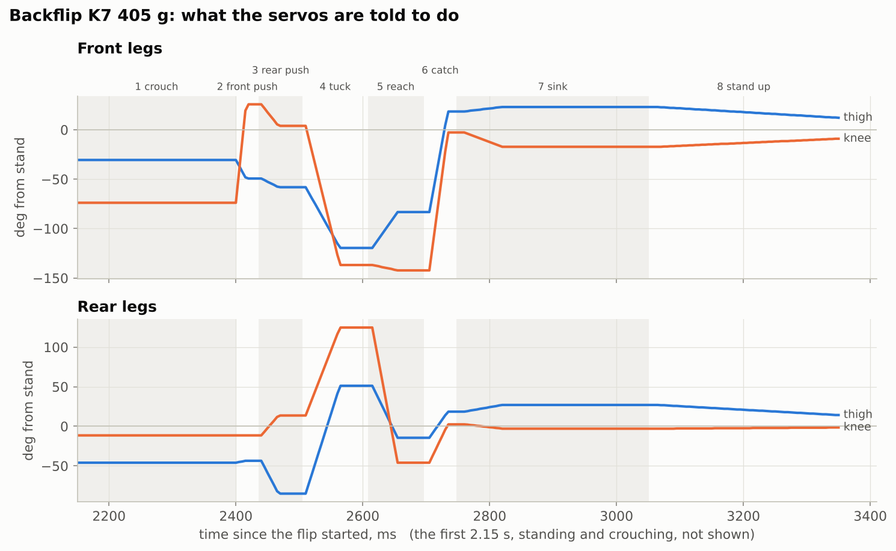
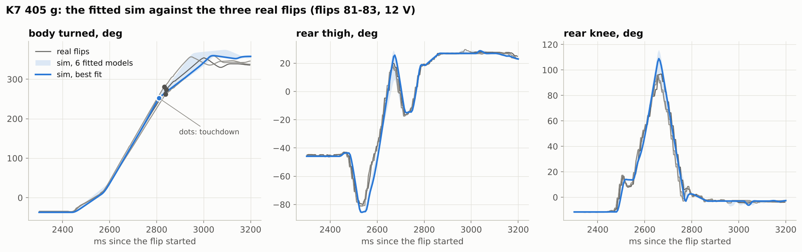
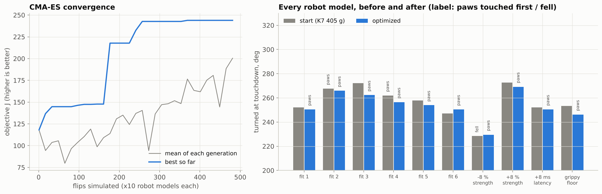
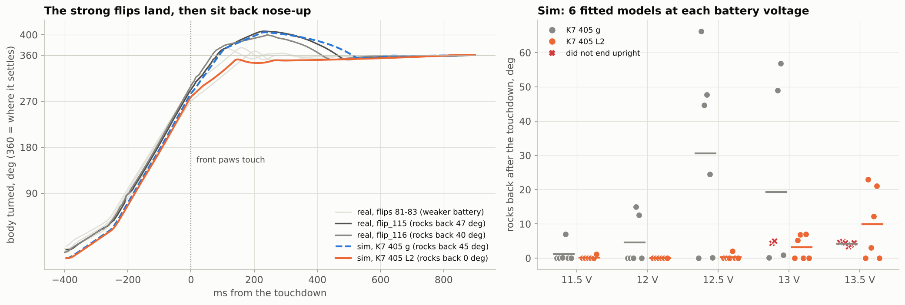
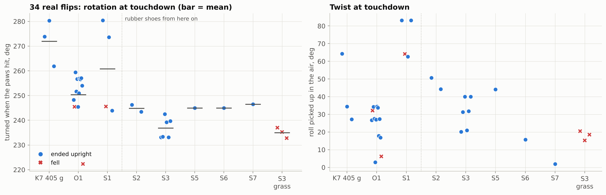
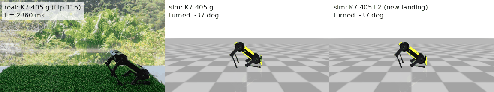

# Mini Pupper 4 backflip: sim to real

[](https://github.com/Bariest/minipupper-backflip/actions/workflows/tests.yml)
[](LICENSE)


**A backflip for a 405 g quadruped with stock hobby servos, designed in simulation and landed on the real robot.** This repo covers the physics, a MuJoCo simulator fitted to real flips, CMA-ES trajectory optimization, analysis tools for the robot's telemetry, and a 75-line firmware player. It also contains everything learned from 36 recorded flips.

<p align="center">
  <br>
  <sub><b>Backflip K7 405 L2</b> on the real robot (left), without the display (top) and with it (bottom), next to the simulator playing the same table (right). Played 3× slower and synced at the moment the front paws touch.</sub>
</p>

| | |
|---|---|
| robot | Mini Pupper 4: 405 g with battery (395 g without the display), 12 stock servos, 3S pack |
| controller | open-loop keyframes: 9 poses, 650 ms from the first push to the end of the landing |
| current flip | **K7 405 L2**: lands front paws first, settles level (no sit-back), with or without the display |
| sim accuracy | servo tracks within 6° RMS, body rotation within 9° RMS of real flips |
| robustness (sim) | upright on 30 / 30 robot models (6 fitted servo models × 11.5-13.5 V) |

## Quick start

```bash
git clone <this repo> && cd minipupper-backflip
pip install -r requirements.txt

python scripts/simulate.py k7_405_l2 --robust          # the current flip on all 10 robot models
python scripts/simulate.py k7_405_l2 --video l2.mp4    # slow-motion video (needs ffmpeg)
python examples/quickstart.py                          # simulate, compare with a real flip, edit a frame
python scripts/analyze_recording.py --all              # measure the 36 recorded flips
python scripts/optimize.py k7_405                      # CMA-ES, ~10 min on 2 cores
python scripts/export_c.py                             # tables -> firmware/presets/*.h
python -m pytest                                       # tests, including C player == Python player
```

Rendering needs an OpenGL context. On a headless Linux machine, set `MUJOCO_GL=egl`.

## How it works

**1. The physics.** All of the spin is loaded in during the ~200 ms push. In the air, the rotation is spin rate × flight time (≈ 1000 °/s × 0.2 s). The flip touches down on the front paws at 250-290° and rolls over them for the rest. The push is limited by servo *speed*, not current, so battery voltage is the biggest knob: about 24° per volt. → [docs/01](docs/01-how-a-backflip-works.md)



**2. Keyframes.** Nine poses: crouch, front push, rear push, tuck, reach, catch, sink, stand. A small player ramps the servos between them in straight lines. It anchors to whatever pose the robot is standing in, and it refuses to play if any joint would pass its end stop. → [docs/02](docs/02-keyframe-flip.md)



**3. A simulator fitted to the robot.** A MuJoCo model of the 405 g robot, including the knee's rod linkage. The servo model (stall torque, back-EMF, gains, 40 ms latency) is fitted to real flips by system identification. Several models fit about equally well, so six are kept as an ensemble. → [docs/03](docs/03-simulation.md)



**4. Trajectory optimization.** CMA-ES searches pose and timing variables in a small box around a working flip. It maximizes `0.6 × mean + 0.4 × worst` of the score over many robot models, so the result has to work on all of them. There are two objectives: the whole flip, and the landing only. → [docs/04](docs/04-trajectory-optimization.md)



**5. Sim to real: the landing.** Filmed flips of the earlier table landed and then sat back 40-47° nose-up. The fitted simulator reproduced that without any change to the model. The landing-only objective then re-tuned frames 5-7 and kept the push. The result, **K7 405 L2**, settles level on the real robot, as in the animation above. → [docs/07](docs/07-sim-to-real-landing.md)



**6. Lessons from 36 real flips.** Shoes, floors, twist, calibration and battery voltage. → [docs/05](docs/05-real-robot.md)



**7. Your robot.** The same method, step by step, for another quadruped. → [docs/06](docs/06-port-to-your-robot.md)

## How the flip evolved

Each table was made in the simulator, tried on the robot, recorded, and the recordings went back into the simulator.

| table | robot | what changed | on the real robot |
|---|---|---|---|
| K7 | 360 g, no battery, ~14.5 V | soft catch: the front paws reach for the floor and the legs give | landed; the base of every later table (`k7_360`) |
| **K7 405 g** | 405 g with battery, 12 V | re-timed for the battery's extra weight; front-knee fold capped to fit the servo range | 262-292° at touchdown, 5 / 5 upright, **but sat back 40-47° on strong flips** |
| O1 | | re-timed in the sim so the front paws touch first | 10 / 11 upright, vaults more |
| S1-S7 | rubber shoes | smaller rear swing (grippy shoes stalled the spin), push timing, twist fixes | S3 best: 6 / 6 upright on carpet |
| G1 | artificial grass | re-timed for a soft floor | not tried |
| **K7 405 L2** | 405 g, with / without display | K7 405 g's push, landing re-tuned by CMA-ES on 30 robot models | **lands level, with and without the display** |

<details>
<summary><b>Previous version: K7 405 g sitting back after the landing</b> (real flip 115 next to the sim, and the sim with L2's landing)</summary>
<p align="center"></p>
</details>

## Repository

```
backflip/            Python package
  robot.py             MuJoCo model, servo map, ServoModel (fitted values + ensemble), floors, display on/off
  keyframes.py         Preset: load/save, the player, rail check, knee cap, C export
  sim.py               simulate() -> FlipResult (time series + touchdown, landing, upright...), scores
  recording.py         load real telemetry, measure it the same way
  sysid.py             fit the servo model to recordings
  optimize.py          CMA-ES over a keyframe table, robust over many robot models
  render.py            video / GIF / chronophotograph / sim-next-to-real
  plots.py             the figures
scripts/             command-line tools (simulate, optimize, fit, analyze, export, figures)
presets/             keyframe tables (JSON)                    -> presets/README.md
firmware/            C player + generated preset headers + a host build for testing
model/               MuJoCo model (MJCF + meshes)
data/recordings/     36 real flips, 200 Hz telemetry           -> data/recordings/README.md
media/               videos of real flips, sim-next-to-real      -> media/README.md
docs/                the guide, with figures
tests/               pytest: C/Python player equality, sim, fit and landing checks
examples/            quickstart.py
```

## Safety

A backflip is hard on the robot. Flip over a firm floor with 1 m of clear space, keep the battery charged, and put a cushion behind the robot the first time you try a new table. Never flip near a table edge. See [docs/05](docs/05-real-robot.md#before-you-flip).

## Contributing

Flips from other Mini Puppers are the most useful contribution. A recording and a video of a flip on a different battery, floor or calibration tells the simulator something new. So do a fix, a new table or a port to another robot. See [CONTRIBUTING.md](CONTRIBUTING.md).

## Citing

If this work helps your research, please cite it. GitHub's "Cite this repository" button uses [CITATION.cff](CITATION.cff).

## Acknowledgements

Developed at [MangDang](https://www.mangdang.net), makers of Mini Pupper. Physics by [MuJoCo](https://mujoco.org). CMA-ES via [`cmaes`](https://github.com/CyberAgentAILab/cmaes).

## License

[MIT](LICENSE), © 2026 MangDang and contributors. This covers the code, the keyframe tables, the recordings, the videos, the figures and the Mini Pupper 4 model and meshes in `model/`, which MangDang releases here under the same license.
