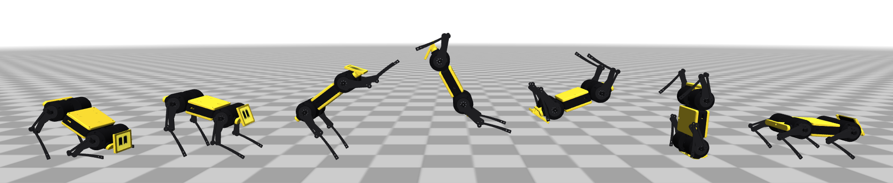
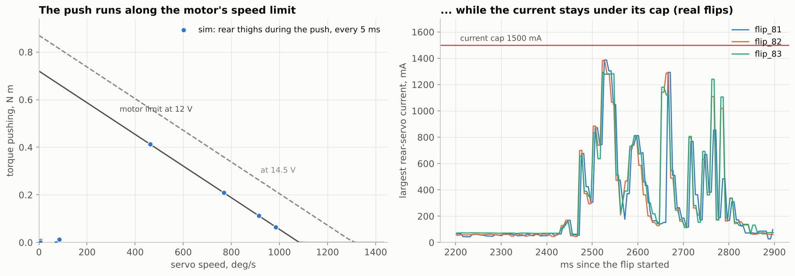

# 1. How a backflip works

A backflip is a rotation problem more than a jumping problem. The robot has to leave the ground already spinning, stay in the air long enough to turn most of the way round, and then catch itself on its paws. This page goes through the physics behind each of those steps, with numbers from the 405 g Mini Pupper 2 and its stock servos at 12 V.

## The spin comes from the ground, and only from the ground

Once the paws leave the floor, nothing can change the robot's angular momentum about its centre of mass. Gravity acts at the centre of mass and the air does nothing measurable, so the whole spin has to be loaded in during the ~200 ms the paws push.

The push spins the body because the floor's reaction force does not pass through the centre of mass. The flip does it in two steps (see [the keyframes](02-keyframe-flip.md)):

1. **Front push (frame 2).** The front legs extend while the rear legs stay crouched. The floor pushes the front up, and the nose starts to rise.
2. **Rear push (frame 3).** The rear thighs swing back hard. The rear paws push down and backwards, which lifts the body and adds to the nose-up rotation. By take-off the body has already turned about 45° and is spinning at roughly 1000 °/s.

## Flight time × spin rate = rotation

With the angular momentum fixed, the rotation in the air is roughly *spin rate × flight time*:

| | sim (fitted) | real (flips 81-83) |
|---|---|---|
| turned at take-off | 46° | - |
| peak spin rate | 1088 °/s | 995-1072 °/s |
| flight | 200 ms, centre of mass 7.7 cm up | 405-410 ms from the push to touchdown |
| turned when the paws hit | 252° | 262-280° |

That works out as 46° + 1040 °/s × 0.2 s ≈ 255°. To turn further you can spin faster, fly longer, or both, and both come from the same push. A Mini Pupper can't really do it by tucking. The legs (thighs and shins) weigh 29 g of the 405 g, because the four hip motors that make up most of the leg mass sit on the body. Folding the legs in only changes the pitch inertia by about 7 %, so the tuck mostly keeps the legs out of the way.

## A Mini Pupper backflip lands on its front paws, then rolls over them

A full 360° in the air is out of reach for these servos. The flip that works instead lands at 250-280°, when the robot is about vertical with its nose down. The front paws touch first, the front legs catch, and the leftover angular momentum carries the body over them for the last ~90°, which finishes the flip on the ground. That gives two failure modes:

* **Under-rotation.** If it touches down much below ~240°, the body or the knees hit the floor before the paws can take the load, and it falls back.
* **Over-rotation.** If it arrives above ~330° with a lot of spin left, it vaults over the front paws and lands on its back.

The optimizer's score (`backflip/sim.py: score`) encodes exactly this. It rewards rotation up to 355°, takes off 40 points if anything other than a paw touches first, and takes off 200 points if the robot does not end upright.

## The servos are speed-limited, not current-limited

A hobby servo's DC motor has a straight torque-speed line, `torque = stall torque − k × speed`. During the rear push the rear thighs reach about 1000 °/s, close to the motor's no-load speed at 12 V, where it has almost no torque left (left panel, sim). On the real robot the rear servos' current stays below the 1500 mA cap the whole time (right panel). Raising the current limit therefore does nothing for the push.

The battery voltage is what matters. Stall torque and no-load speed both scale with voltage, and in the sim every volt adds about 24° at touchdown (see [the real-robot notes](05-real-robot.md#battery-voltage-is-the-biggest-knob)). A table tuned on a full pack (12.6 V) will under-rotate on a tired one (11 V).

## Latency: command the move before you need it

From a command to the servo actually moving takes about 40 ms (SPI, the driver board's loop, the servo's own loop). That fits the recordings best (see [simulation](03-simulation.md)). At 1000 °/s, 40 ms is 40° of rotation, so every frame after take-off has to be sent early. The tuck (frame 4) is commanded about 100 ms before take-off, and the landing reach (frame 5) goes out at take-off, 200 ms before the paws touch. Copy a table from a robot with a different latency and it will land wrong. Measure your own latency and fit it as described in [section 3](03-simulation.md).

## Why flips come down twisted

Mini Pupper's principal moments of inertia, standing (kg mm²):

| axis | roll (x) | **pitch (y)** | yaw (z) |
|---|---|---|---|
| inertia | 365 | **1019** | 1283 |

The backflip spins about the pitch axis, which is the intermediate of the three, and rotation about the intermediate axis is unstable (the [tennis-racket theorem](https://en.wikipedia.org/wiki/Tennis_racket_theorem)). A small roll or yaw rate at take-off grows about e-fold every ~90 ms in flight, so over 200 ms it grows about ×9. The real flips arrive with 20-80° of roll at touchdown (see [figure](05-real-robot.md#twist)).

Nothing in the air can stop this, because the legs are too light. The flip only lands straight if it leaves the ground straight. That means symmetric pushes, legs calibrated to match left and right, and a floor that grips both rear paws the same. A shorter flight also lets the twist grow less.
