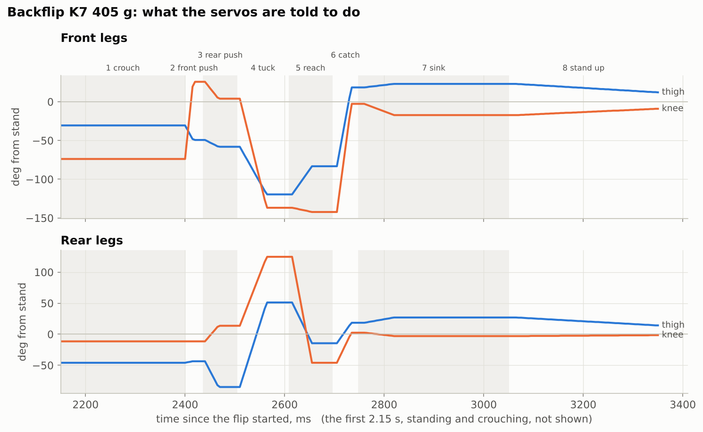

# 2. The keyframe flip

There is no model-predictive control here and no learned policy. The whole flip is **nine poses with timings**, played open-loop by a small player in the firmware. It works because the hard part, getting the poses and timings right, is done offline against a simulator that was fitted to the real robot ([section 3](03-simulation.md)).

## The table

`presets/k7_405.json`: 9 frames, values in servo ticks relative to the stand pose (1 tick = 0.3027°). The left legs mirror the right ones, and the hips stay at 0.

```
frame  move  hold  |   FR thigh    FR knee   RR thigh    RR knee   (deg from stand)
    0  1000   500  |          0          0          0          0     stand
    1   600   300  |        -31        -74        -46        -12     crouch (front low, nose down ~37 deg)
    2    16    20  |        -49         26        -44        -12     front push: front knees snap straight
    3    27    42  |        -58          4        -85         14     rear push: rear thighs swing back hard
    4    54    49  |       -120       -137         51        125     tuck
    5    40    48  |        -83       -142        -15        -46     reach: front legs out to catch
    6    29    23  |         18         -3         18          2     catch
    7    60   243  |         23        -17         27         -3     sink into the landing
    8   600   300  |          0          0          0          0     stand up
```



A few things to notice:

* **The moves are fast.** Frames 2-7 ramp in 16-60 ms. Anything faster than the servo can follow simply turns into "go there at full speed". The time that actually matters is when each frame *starts*, which is the sum of the previous frames' `move + hold`.
* **The flip proper is 650 ms.** Frames 0 and 1 (1.5 s plus 0.9 s) are only the stand and the crouch, and frame 8 is the stand-up.
* **The front knees fold at most 142° (470 ticks).** A servo has 1024 ticks over 310°, so from a centred stand it has 511 ticks each way. The original table folded the front knees 554 ticks, which only fits when the knee's calibration offset happens to leave room. `Preset.cap_front_knees()` caps the fold. In the sim the cap costs no rotation, and with it every table here fits an all-centred stand with 12° to spare.

## The player

`firmware/backflip_player.c` (75 lines, no heap, no libm):

```c
#include "backflip_player.h"
#include "presets/k7_405.h"

bf_player_t p;
uint16_t stand[12], targets[12];

read_servo_positions(stand);                       // where the robot stands right now
if (bf_start(&p, &BF_K7_405, stand, millis()) != BF_OK) {
    // a frame would drive servo p.rail_servo past its end stop: refuse, do not clip
}
while (bf_tick(&p, millis(), targets)) {           // call it from your 5 ms servo loop
    send_servo_targets(targets);
    wait_for_next_5ms_tick();
}
```

Semantics, exactly the same in C (`bf_tick`) and Python (`Preset.play`), and checked tick for tick by `tests/test_player.py`:

* When frame *f* is armed, every servo ramps in a straight line from its last target to `stand + frames[f]` over `move_ms[f]`.
* Frame *f + 1* is armed `move_ms[f] × blend_pct[f] / 100 + hold_ms[f]` later. A blend below 100 starts the next frame before this one has arrived.
* Targets are rounded to whole ticks and clamped to 0..1023.

**Anchor to the pose the robot is in.** `bf_start` adds the table's deltas to the pose the servos report right now, not to a stored calibration. The table then carries over between robots and calibrations, as long as the robot really is standing in its normal stand when you press the button.

**Refuse, never clip.** If any frame would pass a servo's end stop from this stand, `bf_start` returns `BF_ERR_RAIL` and plays nothing. Clipping one joint changes the flip, and it would land wrong. Fix the calibration instead. The usual culprit is a knee whose horn sits a spline off, so its stand pose is far from centre.

## Around the player (what the full firmware also does)

These are not in the minimal player, but the robot needs them:

1. **Servo gains.** The flip plays on the servos' "Strong" preset (stiff position loop), and your normal gains come back afterwards. On soft walking gains the push is far weaker.
2. **Current limit.** 1500 mA per servo on the stock servos. The push does not reach it ([why](01-how-a-backflip-works.md#the-servos-are-speed-limited-not-current-limited)), but the landing does briefly.
3. **Telemetry.** Record 200 Hz of servo positions, currents and the IMU from the moment frame 0 is armed (`mark_s` in the CSV). Every lesson in [section 5](05-real-robot.md) came from these recordings.
4. **One button.** Gains, load the table, cap the front knees, anchor, rail check, play, restore gains. Make that a single command so a demo can't skip a step.

## Exporting a table to C

```
python scripts/export_c.py                 # presets/*.json -> firmware/presets/*.h
```

Each header defines a `bf_table_t` named `BF_<NAME>` (for example `BF_K7_405`).
