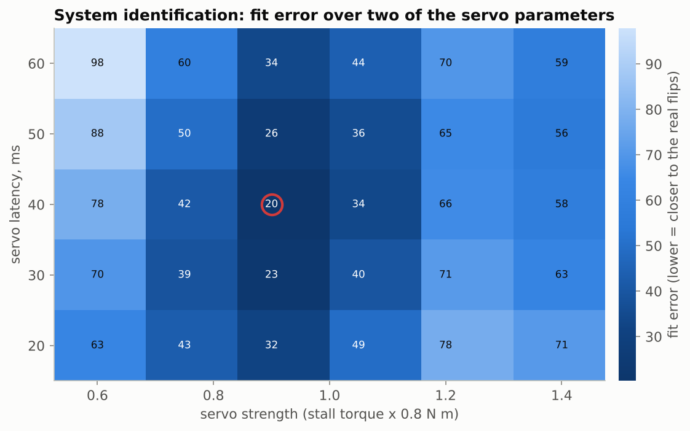
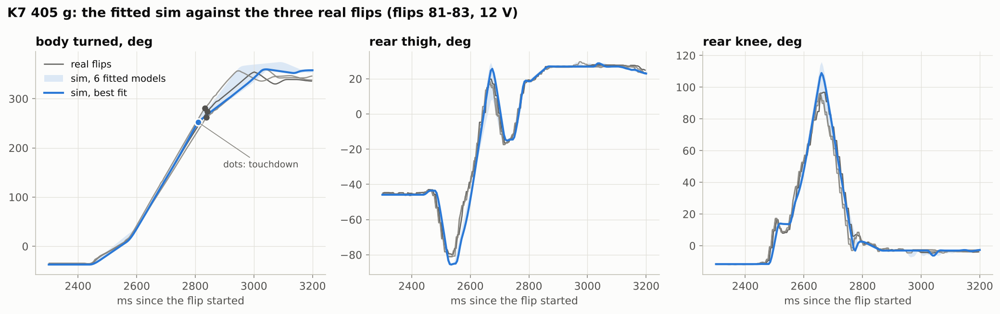
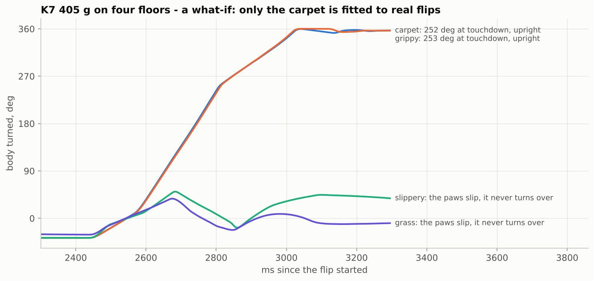

# 3. Simulation and system identification

A simulator only helps if it flips like the real robot, and an out-of-the-box servo model doesn't. Before fitting, the sim's servo tracks were off by 25° RMS and its body rotation by 28° RMS. After fitting to 14 real flips, those errors drop to 6° and 9°.

## The model

`model/minipupper4.xml` is the Mini Pupper 4 at 405 g. It includes the 35 g battery at the back and the 10 g display at the front, and its weight split (177 g on the front paws, 223 g on the rear) was checked on the real robot. Collision geometry is simple: a cylinder for each hip motor, capsules for the thighs and shins, and a 5.5 mm sphere for each paw.

| part | how it is modelled |
|---|---|
| hip, thigh servo | MuJoCo `position` actuator on the joint |
| knee servo | the knee motor sits at the hip and drives the shin through a rod, so the shin's angle to the vertical is what the servo sets. Modelled as a fixed **tendon** (thigh + knee hinge) that the actuator drives |
| servo dynamics | `torque = clip(kp·err − kv·speed, ±umax) − damping·speed`, plus rotor inertia (armature). The damping is the motor's back-EMF, so the top speed is `umax / damping` |
| latency | the command reaches the servo `latency_ms` late |
| timing | the firmware's loop: new targets every 5 ms, five 1 ms physics steps in between |

`backflip/robot.py: ServoMap` converts the firmware's servo angles into the model's joint angles, including the knee rod linkage. A table therefore runs in the sim unchanged, tick for tick as the robot plays it.

## Fitting the servo model

The unknowns are stall torque (strength), back-EMF (damping), the position and velocity gains, latency, a possible speed cap inside the servo, and floor grip. The fit (`backflip/sysid.py`, `scripts/fit_servo_model.py`) replays the exact table each recording played, for every model on a grid (1296 models), and scores each one against the recordings:

```
error = servo + 0.5 pitch + 0.3 |touchdown time error, ms| + 0.3 |touchdown angle error, deg|
servo = RMS of the 8 thigh + knee servo tracks from the push to the touchdown, deg
pitch = RMS of the body-rotation curve, deg
```

The recordings were 3 flips of K7 405 g and 11 of O1, all at 12 V without shoes. Each table carries the same total weight in the score.



The best model: strength 0.9 (0.72 N m stall at 12 V), damping ×1.0, `kp` ×2, latency 40 ms, floor grip 0.7. Several quite different models fit almost as well, for example stronger but more damped servos, or a speed cap with less latency. The data can't tell them apart, so the six best *different* models are kept as an **ensemble** (`backflip/robot.py: ENSEMBLE`). The optimizer only trusts a table that works on all of them.



| | before fitting | fitted |
|---|---|---|
| servo tracks, RMS | 25° | 6° |
| body rotation, RMS | 28° | 9° |
| touchdown time, mean error | 21 ms | 17 ms |
| rotation at touchdown, mean error | 27° | 8° |

## How far to trust it

* **Comparisons are reliable, absolute angles less so.** The sim puts K7 405 g's touchdown at 252°, while the real flips measured 262-280°. For O1 it is within 2°. Use the sim to tell which of two tables turns further, and expect the real robot to land within ±20° of the sim.
* **Only indoor flips at ~12 V without shoes are fitted.** The floor grip (0.7) is one number that also absorbs the paws' rubber.
* **Floors are what-ifs.** The grass model (soft, damped contact) reproduces the three failed grass flips, but nothing else was fitted on it. In the sim, K7 405 g slips and never turns over on a slippery floor (grip 0.4) or on grass. S3, with its gentler rear push, still takes off.



* **No twist.** The model is left-right symmetric, so it flips perfectly straight. The real robot does not ([why](01-how-a-backflip-works.md#why-flips-come-down-twisted)).

## Fit your own robot

1. Record 3-10 flips of one table (see [section 5](05-real-robot.md#recording-a-flip)) and add them to `data/recordings/index.csv` with the table each one played.
2. `python scripts/fit_servo_model.py --recordings flip_1 flip_2 flip_3` (try `--quick` first).
3. Copy the best model and the ensemble from `data/servo_fit.json` into `backflip/robot.py` (`FITTED`, `ENSEMBLE`).
4. Check: `python scripts/analyze_recording.py flip_1 flip_2 flip_3 --sim <table> --plot check.png`.
