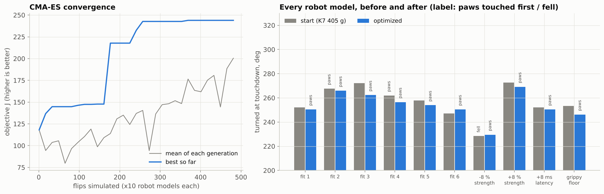

# 4. Trajectory optimization

Hand-tuning 9 frames × 12 servos × 2 timings is how the first flips were made, and it is slow. The optimizer searches the same table space automatically against the fitted sim, and it keeps every result a small, explainable edit of a flip that already works on the robot.

```
python scripts/optimize.py k7_405                   # 30 generations x 16, ~10 min on 2 cores
```

## What it searches

`backflip/optimize.py: Space`. For each frame from 1 to N-2, it searches:

| variable | box around the starting table |
|---|---|
| front thigh, front knee target | ±40 ticks (±12°) |
| rear thigh, rear knee target | ±60 ticks (±18°), because the rear legs do the push |
| `move_ms`, `hold_ms` | 0.5× to 1.6× + 30 ms |

The left legs mirror the right ones and the hips stay at 0, which leaves 42 variables for K7. The front-knee cap and the servo end stops still apply. Any joint that would come within 6 ticks of an end stop, from an all-centred stand, is penalized.

## The objective: robust, not best-case

One sim run can't be trusted. The fit leaves several servo models that match the recordings about equally well ([section 3](03-simulation.md)), and the robot's battery, floor and servo temperature all vary. Every candidate is therefore flown on **10 robot models**: the 6 fitted models, plus the best fit with 8 % weaker servos, 8 % stronger servos, 8 ms more latency, and a grippier floor. Then

```
J = 0.6 × mean(score) + 0.4 × min(score) − rail penalty
score = min(rotation at touchdown, 355) − 40 if not paws first − 200 if it does not end upright  (+ over-rotation penalties)
```

The `min` term is what matters most. A table that is great on nine models and falls on the tenth loses to one that is merely good on all ten.

## Why CMA-ES

The objective is noisy and full of cliffs: one ms of timing can be the difference between paws-first and knee-first. It has no gradient, and 42 dimensions is too many for a grid. CMA-ES ([Hansen 2016](https://arxiv.org/abs/1604.00772)) handles exactly this case. It samples a population around a mean, moves the mean toward the best samples, and adapts a full covariance, so it learns which variables have to move together (for example a later push needs a later tuck). It needs no tuning beyond the step size (0.15 of each box) and the population (16). Each generation's 16 × 10 flips run in parallel on all cores.

## Result: K7 405 g → `presets/k7_405_opt.json`



| | K7 405 g | optimized |
|---|---|---|
| objective J | 118 | **244** |
| rotation at touchdown (10 models) | 228-273°, mean 257° | 230-269°, mean 253° |
| paws touch first | 2 / 10 | **10 / 10** |
| ends upright | 9 / 10 (falls with 8 % weaker servos) | **10 / 10** |

The optimizer didn't buy more rotation. At 12 V the push is speed-limited ([section 1](01-how-a-backflip-works.md#the-servos-are-speed-limited-not-current-limited)), so no table can add much. What it bought is a cleaner landing: the paws reach the floor before the knees and body on every model, including the weak-servo one where K7 405 g falls. The main changes are a slightly deeper rear crouch, a 10° harder rear push, and a later, longer reach (frame 5: 47 + 77 ms instead of 40 + 48).

> **Status: not yet tried on the real robot.** The sim ranks tables well but puts the landing ±20° off ([section 3](03-simulation.md#how-far-to-trust-it)). Try it over a soft mat first, record it, and compare.

## A second objective: the landing

`--objective landing` scores only what happens after the front paws touch: how far it rocks back, how hard the rear legs come down, paws first, and ending upright. Combined with `--frames 5 6 7` it re-tunes the landing and leaves the push alone. [Section 7](07-sim-to-real-landing.md) uses it to fix a landing seen on the real robot.

## Useful variations

```
python scripts/optimize.py k7_405 --volts 11.1          # tune for a tired battery
python scripts/optimize.py k7_405 --frames 4 5 6 7      # landing only, keep the push
python scripts/optimize.py k7_405 --no-timing           # poses only
python scripts/optimize.py k7_405 --gens 60 --pop 24    # longer search
python scripts/simulate.py k7_405 k7_405_opt --robust   # compare tables on all 10 models
```

## Lessons from many optimizer runs

* **Optimize for robustness from day one.** Tables tuned on a single sim model, or on a fit made before the battery was added, did much worse on the robot than in the sim.
* **Keep the boxes small.** A large box finds "flips" that exploit the sim, such as a knee pushing off the floor or a perfectly timed bounce. A small box around a real flip stays inside what the sim was fitted on.
* **Re-fit before re-optimizing** whenever the hardware changes: a new battery, new servos, new firmware gains.
