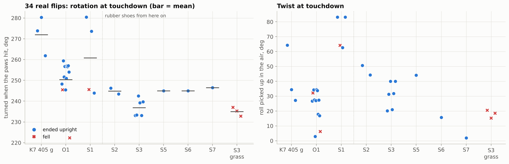
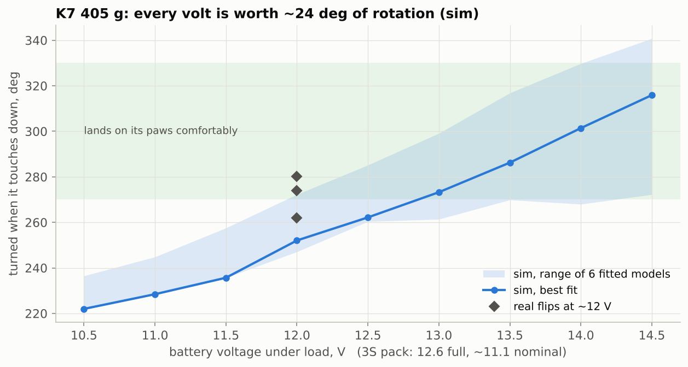

# 5. On the real robot

Everything in this repo was checked against 36 recorded flips of one Mini Pupper 4: 405 g, stock servos, a 3S pack at about 12 V, Strong servo gains, and a 1500 mA current limit. They are all in [`data/recordings`](../data/recordings), each labelled in `index.csv` with the table it played, the floor, and whether it wore shoes.

## Recording a flip

The firmware logs 200 Hz telemetry from the moment frame 0 is armed:

```
# mark_s=1.4936          <- frame 0 armed: t = 0 for the analysis
t_s,pos1..pos12,cur1..cur12,ax,ay,az,gx,gy,gz
```

`pos` is the servo's raw angle (deg), `cur` is the motor current (mA), `a*` is acceleration (g) and `g*` is angular rate (°/s) from the BMI270. On Mini Pupper 4 the IMU's x axis points left, y forwards, z down. The flip's rotation is therefore −gx, roll is +gy and yaw is −gz.

```
python scripts/analyze_recording.py flip_81 flip_82 flip_83
python scripts/analyze_recording.py --all
python scripts/analyze_recording.py my_flip.csv --sim k7_405 --plot check.png
```

`backflip/recording.py` measures each flip the same way the sim does:

* **spin start**: the first moment the rotation rate passes 200 °/s.
* **push**: the first jolt over 2 g in the 150 ms before the spin starts.
* **touchdown**: the first jolt over 3 g once the body has turned past 150°.
* **rotation**: the gyro integrated. It is accurate to a few degrees over a 1 s flip.
* **twist**: roll and yaw picked up between the spin start and the touchdown.
* **ended upright**: gravity on −z for the last 0.3 s.

## 36 flips



| table | flips | turned at touchdown | ended upright | notes |
|---|---|---|---|---|
| **K7 405 g** | 3 | 272° (262-280) | 3 / 3 | **the best without shoes** |
| O1 | 11 | 253° (245-259) | 10 / 11 | paws first more often, vaults more |
| S1 / S2 | 6 | 243-280° | 5 / 6 | rubber shoes |
| S3 | 6 | 237° (233-242) | 6 / 6 | rubber shoes, carpet |
| S3 on grass | 3 | 235° (233-237) | **0 / 3** | soft floor |
| K7 405 g on a thin grass mat | 2 | 286° (280-292) | 2 / 2 | strong flips: sat back 40-47° after landing ([docs/07](07-sim-to-real-landing.md)) |
| **K7 405 L2** on the grass mat | 2 (video only) | - | 2 / 2 | landed level, with and without the display ([docs/07](07-sim-to-real-landing.md#on-the-robot)) |

## What we learned

### K7 405 g beats S3 without shoes

S3 was tuned for grippy rubber shoes. With shoes, K7's big rear-thigh swing made the rear paws grip too long and the spin stalled, so S3 swings the rear thighs less and pushes on different timing. Without shoes, that smaller swing simply means less spin. K7 405 g turns 35° further at touchdown (272° vs 237°) and lands just as reliably. **Match the table to what is on the paws.**

### Battery voltage is the biggest knob



The push is limited by servo speed, which scales with voltage. The current limit doesn't constrain it ([section 1](01-how-a-backflip-works.md#the-servos-are-speed-limited-not-current-limited)). In the sim, K7 405 g gains about 24° at touchdown per volt. In the sim, a pack holding 12.5 V under load turns about 35° further than one sagging to 11 V. Tune on the voltage you will demo on, and charge the pack before a demo. Raising the current limit would not help the push.

### Floors and shoes change the flip

* **Rubber shoes** grip better, which helps the landing but can stall the push. They need their own table (S3).
* **Artificial grass** is soft: the paws sink in and the push is absorbed. S3 lost no rotation (235° vs 237°) but fell all three times, because the landing has nothing firm to vault over. In the sim, K7 405 g doesn't take off at all on grass. Flip on a firm floor.
* **A table top** worked well with K7 405 g. Keep the robot well away from the edge: a flip travels a few cm backwards and can twist sideways.

### Twist

Real flips arrive with 20-80° of roll ([why](01-how-a-backflip-works.md#why-flips-come-down-twisted)). The flips that land straightest are the ones where both rear legs push identically. On this robot the rear-left leg lagged the rear-right by 10-16° during the push, which looks like a calibration or horn offset. Giving the rear-left thigh a 60-tick head start (S7) brought one flip down with 2° of roll. Before tuning tables for twist, calibrate the legs so that left and right really are mirror images.

### Calibration and the servo's range

A servo has 310° of travel (1024 ticks), 155° each way from centre. The flip folds the front knees 142° from the stand, so a knee whose horn is mounted a spline off can run out of range. The firmware refuses to play rather than clip (`bf_start` → `BF_ERR_RAIL`, or "anchoring hit a joint rail" in the full firmware). The fix is mechanical: re-seat the horn so the stand pose is near the servo's centre. Every table here fits an all-centred stand with 41 ticks (12°) to spare.

### Gains and current

* Play the flip on the **Strong** gains preset and restore the walking gains afterwards. On soft gains the servos lag and the push is weak.
* 1500 mA per servo on the stock servos. The push stays below it. Landing peaks come close, and in a few S3 flips they briefly read above it.

## Before you flip

1. Battery charged (≥ 12 V under load), robot on a firm, non-slippery floor, 1 m clear all round.
2. Robot standing in its normal stand. The one-button flip anchors to the pose it is in.
3. First try of a new table: put a soft mat or a cushion behind the robot.
4. Record every flip. Two minutes with `analyze_recording.py` will tell you more than ten flips by eye.
