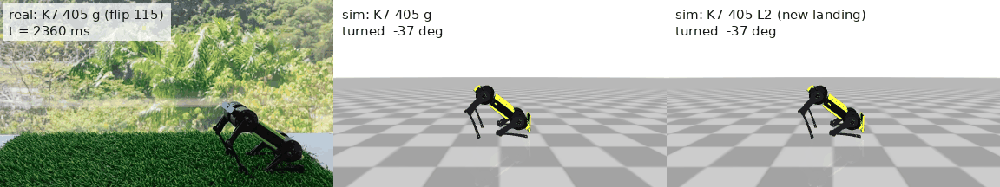
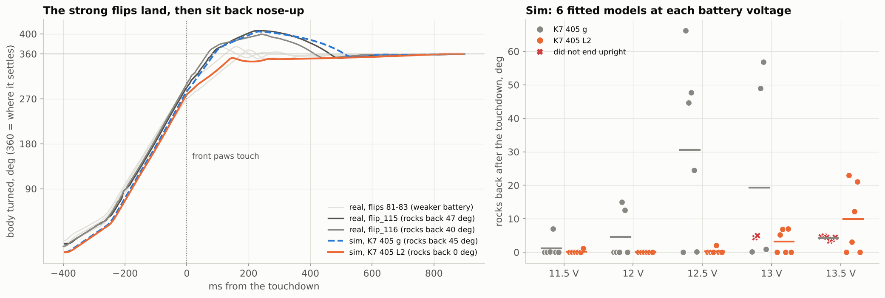

# 7. Sim to real: fixing a landing that sits back



*Left: the real robot (flip 115, filmed at 60 fps, played 3× slower). Middle: the fitted simulator playing the same table. Right: the simulator with the re-tuned landing. The real flip and the middle panel do the same thing: the front paws touch at about 285°, and then the robot sits back nose-up before it settles.*

## What the robot did

Two flips of **K7 405 g** were recorded on 2026-11-11 on a thin, firm grass mat. Flip 115 had the display removed and flip 116 had it fitted. Videos are in [`media/`](../media) and telemetry in [`data/recordings`](../data/recordings).

| | turned at touchdown | rocks back after the touchdown | rear-legs impact | ended |
|---|---|---|---|---|
| flip 115 (no display) | 280° | **47°** | 4.8 g | upright |
| flip 116 (display) | 292° | **40°** | 6.8 g | upright |
| flips 81-83 (2026-11-09) | 262-280° | 8-15° | 11-14 g | upright |

Both flips spun harder than the earlier ones, most likely from a fuller battery. That spin has to go somewhere after the front paws catch. The body rolls over the front legs, the rear comes down, and with spin still left the robot sits back about 40° nose-up before it rocks forward and settles. *Rocks back* is how far the body turns past where it finally stands, from the IMU. `backflip.sim.landing_metrics` measures it the same way for the sim and for real flips.

The display weighs 10 g. In the sim, removing it costs 3° at touchdown, which is well inside the 12° the two real flips differ by, so it doesn't matter for the flip.

## The sim does the same thing

The fitted model needs no change to reproduce this. Its six models at 12.5 V cover these flips: one of them turns 285° and rocks back 45° (dashed line below). Pushed harder, K7 405 g gets worse. At 13 V two of the six models don't end upright, and at 13.5 V none of them do. The table that lands best is sitting close to the edge.



## Re-tuning only the landing

The push already works on the robot, so it was left alone. Frames 0-3 are K7 405 g's, unchanged, which means take-off is identical. The optimizer could change:

* the poses of frames 5-7 (reach, catch, sink): front ±60 ticks, rear ±80 ticks;
* the timing of frames 4-7.

It ran a new objective, `backflip.sim.landing_score`:

```
score = - (rocks back - 10 deg)+  - 3 x (rear impact - 6 g)+  - 25 if not paws first  - 200 if not upright
```

That score was flown on the 6 fitted models at every battery voltage from 11.5 V to 13.5 V (30 flips per candidate). There were two CMA-ES runs: 40 generations on 12-13.5 V, then 16 more starting from that result with 11.5 V added.

```
python scripts/optimize.py k7_405 --objective landing --frames 5 6 7 --timing-frames 4 5 6 7 \
       --volts 12 12.5 13 13.5 --range 60 --rear-range 80 --gens 40 --name "Backflip K7 405 L2" --out presets/k7_405_l2.json
python scripts/optimize.py presets/k7_405_l2.json --objective landing --frames 5 6 7 --timing-frames 4 5 6 7 \
       --volts 11.5 12 12.5 13 13.5 --range 30 --rear-range 40 --sigma 0.12 --gens 16 --name "Backflip K7 405 L2"
```

## Result: `presets/k7_405_l2.json` ("Backflip K7 405 L2")

Six fitted models at each voltage:

| battery | K7 405 g: upright · paws first · rocks back (worst) | **K7 405 L2** |
|---|---|---|
| 11.0 V *(not tuned for)* | 4/6 · 0/6 · 20° (59°) | 2/6 · 2/6 · 47° (115°) |
| 11.5 V | 6/6 · 0/6 · 1° (7°) | 6/6 · 4/6 · 0° (1°) |
| 12.0 V | 6/6 · 2/6 · 5° (15°) | **6/6 · 6/6 · 0° (0°)** |
| 12.5 V | 6/6 · 1/6 · 31° (66°) | **6/6 · 6/6 · 0° (2°)** |
| 13.0 V | 4/6 · 1/6 · 19° (57°) | **6/6 · 6/6 · 3° (7°)** |
| 13.5 V | 0/6 · 5/6 · 4° (5°) | **6/6 · 6/6 · 10° (23°)** |
| 14.0 V *(not tuned for)* | 2/6 · 4/6 · 25° (73°) | **6/6 · 6/6 · 19° (33°)** |

The rear-legs impact also drops, from 5.6-8.8 g to 5.1-6.6 g.

What changed, in degrees from the stand (right legs; the left mirror them):

| frame | | K7 405 g | L2 |
|---|---|---|---|
| 4 tuck | move + hold | 54 + 49 ms | 74 + 37 ms (the reach starts 8 ms later) |
| 5 reach | front thigh / knee | −83 / −142 | −94 / −135 (front legs reach further) |
| | rear thigh / knee | −15 / −46 | −8 / −55 |
| 6 catch | front knee, rear knee | −3, +2 | −12, +19 |
| 7 sink | rear knee | −3 | **+29** |
| | move + hold | 60 + 243 ms | 93 + 158 ms |

The front legs reach further, and both pairs of legs **land bent and keep folding**: the rear knees by about 30°. The leftover spin goes into bending the legs instead of throwing the rear down and sitting the robot back.

## Status and how to try it

**L2 has not been tried on the robot yet.** In the firmware it is the one-button flip **"Backflip K7 405 L2 (softer landing)"**. Try it on a fresh or fully charged battery, which is the case it was made for. On a tired battery (under ~11.5 V) K7 405 g is the safer choice. Record the flips and compare:

```
python scripts/analyze_recording.py my_l2_flip.csv --sim k7_405_l2 --plot l2_check.png
```

The numbers to watch are *rocks back* (K7 405 g today: 40-47°) and whether the front paws touch first.

## Make the same comparison for your own video

```python
from backflip import Preset, ENSEMBLE, ENSEMBLE_FLOORS, simulate, render
sims = [simulate(Preset.load(n), ENSEMBLE[2].at(12.5), ENSEMBLE_FLOORS[2]) for n in ("k7_405", "k7_405_l2")]
render.sim_vs_real_video("media/flip_115_no_screen.mp4", 2.62, sims, ["sim: K7 405 g", "sim: L2"], "out.mp4")
```

The offset (2.62 s) is the video time of the flip's t = 0. Find it from one clear moment: the frame where the front paws touch, minus the touchdown time the IMU measured (`recording.load(...).metrics["t_td"]`).
